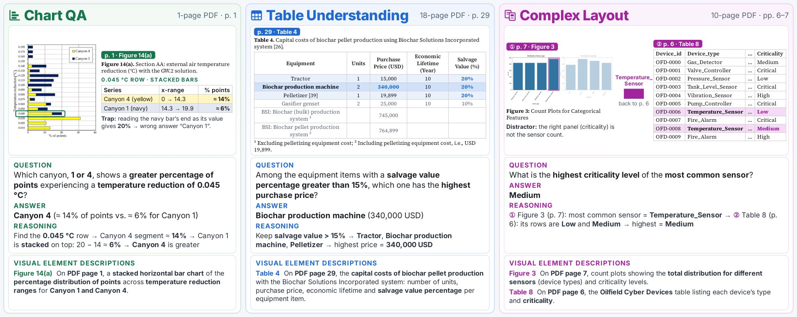

# VELD-QA: A Large-Scale Dataset for Visual Evidence Grounding and Question Answering in Long Documents

**[Paper](https://arxiv.org/abs/2610.20964)** · **[Dataset download](docs/DATA_DOWNLOAD.md)** · **[Data format](docs/DATA_FORMAT.md)** · **[Citation](#citation)**

## Overview

VELD-QA evaluates evidence localization and visual reasoning in document
question answering. Human-authored questions are paired with reference answers,
supporting-page annotations, evidence-element identifiers, and descriptions of
the cited visual content.

[](https://arxiv.org/html/2610.20964v1#S1.F1)

The full benchmark contains 15,000 question-answer pairs, 5,859 PDF
files, and 372,445 pages. This release contains the 12,077 training
and 1,471 development questions and their source documents.

## Benchmark composition

VELD-QA covers three categories, each with 5,000 questions in the full benchmark:

| Category | Task | Document assets |
| --- | --- | --- |
| **Chart understanding** | Interpret individual charts and compare graphical evidence on a single page. | PDFs |
| **Table understanding** | Locate supporting tables and reason about their contents in multi-page documents. | PDFs and transcribed Excel workbooks |
| **Complex-layout understanding** | Combine evidence from text, tables, charts, and figures. | PDFs |

The table below summarizes the training and development questions and their
source documents included in this release:

| Category | Train | Dev | Released questions | Referenced PDFs | Excel workbooks |
| --- | ---: | ---: | ---: | ---: | ---: |
| Chart understanding | 4,135 | 452 | 4,587 | 2,047 | 0 |
| Table understanding | 3,941 | 523 | 4,464 | 1,244 | 1,244 |
| Complex-layout understanding | 4,001 | 496 | 4,497 | 2,001 | 0 |
| **Total** | **12,077** | **1,471** | **13,548** | **5,292** | **1,244** |

PDF counts refer to file paths, not unique byte contents. Within each category,
train and development records reference disjoint PDF paths. The asset folders
contain only the PDFs and workbooks referenced by these released splits.

## Released data

Each category contains UTF-8 JSON Lines annotations and its document assets:

```text
.
├── README.md
├── Attribution.txt
├── CITATION.cff
├── CONTRIBUTING.md
├── LICENSE.txt
├── SECURITY.md
├── Third-Party-Licenses.txt
├── assets/
│   └── veld-qa-overview.png
├── docs/
│   ├── DATA_DOWNLOAD.md
│   └── DATA_FORMAT.md
├── chart_understanding/
│   ├── train.jsonl
│   ├── dev.jsonl
│   └── pdfs/
├── table_understanding/
│   ├── train.jsonl
│   ├── dev.jsonl
│   ├── pdfs/
│   └── tables/
└── complex_layout/
    ├── train.jsonl
    ├── dev.jsonl
    └── pdfs/
```

`pdf_uri` and `table_uri` are paths relative to the repository root. Questions
can share documents. `description` is a JSON object mapping evidence identifiers
to descriptive text; `reference_answer` is the answer target. See
[Data format](docs/DATA_FORMAT.md) for all fields and page-label conventions.

This package supplies data and documentation. It does not include the paper's
evaluation runner, model outputs, or judge implementation.

## Getting started

### Prerequisites

- Git and [Git LFS](https://git-lfs.com/) to download PDFs and Excel workbooks.
- Python 3 to run the examples; no third-party Python packages are required.
- Approximately **38 GB of free disk space** for the asset checkout and local
  Git LFS object cache.

### Download the dataset

Install Git LFS, then clone the repository:

```bash
git lfs install
git clone https://github.com/oracle-samples/veld-qa.git
cd veld-qa
git lfs pull
```

PDFs and Excel workbooks are tracked through Git LFS. Their checked-out files
occupy approximately **18.7 GB**. The annotations are ordinary Git files and can
be read without downloading the document assets. See
[Download instructions](docs/DATA_DOWNLOAD.md) for an annotations-only clone,
category-specific downloads, and verification.

No hosted model service is needed to inspect the dataset. Running model
experiments requires the model access and inference environment of your choice.

## Documentation

- [Paper](https://arxiv.org/abs/2610.20964): construction, experimental settings,
  results, and annotation-enrichment studies.
- [Data format](docs/DATA_FORMAT.md): schema, identifiers, descriptions, and
  evidence-page conventions.
- [Download instructions](docs/DATA_DOWNLOAD.md): Git LFS setup and asset checks.

## Examples

Read the first chart development example from the repository root:

```bash
python3 - <<'PY'
import json
from pathlib import Path

root = Path.cwd()
path = root / "chart_understanding/dev.jsonl"
with path.open(encoding="utf-8") as handle:
    example = json.loads(next(handle))

print("Example:", example["example_id"])
print("Question:", example["question"])
print("Reference answer:", example["reference_answer"])
print("PDF:", root / example["pdf_uri"])
print("Evidence:", example["evidence_ids"])
print("Page labels:", example["evidence_page_ids"])
print("Descriptions:", example["description"])
PY
```

Validate the JSONL files and count their records:

```bash
python3 - <<'PY'
import json
from pathlib import Path

for category in ("chart_understanding", "table_understanding", "complex_layout"):
    for split in ("train", "dev"):
        path = Path(category) / f"{split}.jsonl"
        count = 0
        with path.open(encoding="utf-8") as handle:
            for line in handle:
                record = json.loads(line)
                assert record["dataset"] == category
                assert record["data_split"] == split
                assert isinstance(record["description"], dict)
                count += 1
        print(f"{path}: {count:,} questions")
PY
```

## Evaluation

VELD-QA evaluates visual evidence grounding and document question answering.
For each question, generate an answer under the chosen evidence-access setting
and compare it with the reference answer. Supporting-page and evidence-element
annotations enable evaluation of evidence localization. The paper describes
question-only, gold-page, top-3 retrieval, and all-page settings, alongside
retrieval-augmented and agentic systems. See Section 4 and Appendix C of the
[paper](https://arxiv.org/abs/2610.20964) for the evaluation protocol.

Keep reference answers out of answering-model inputs and use gold evidence
annotations only when the evaluation setting permits them. The released package
supplies annotations and source documents; evaluation runners, model outputs,
and judge implementations are not included.

## Help

For questions or reproducible problems involving the released benchmark
artifacts, open a GitHub issue with the category, split, `example_id`, and enough
information to reproduce the problem. Include the affected field and supporting
document location so the annotation can be checked. Do not use GitHub issues to
report security vulnerabilities.

## Contributing

This project welcomes contributions from the community. Before submitting a
pull request, please review our [contribution guide](CONTRIBUTING.md), including
the Oracle Contributor Agreement and commit sign-off requirements.

## Security

See [SECURITY.md](SECURITY.md) for Oracle's vulnerability-reporting process.
Security vulnerabilities must not be reported through public GitHub issues.

## License

Copyright (c) 2026 Oracle and/or its affiliates.

VELD-QA is licensed under the Creative Commons Attribution-ShareAlike 4.0
International License (CC BY-SA 4.0), except where otherwise noted. See
[LICENSE.txt](LICENSE.txt) for the license terms, [Attribution.txt](Attribution.txt)
for source-specific copyright and attribution information, and
[Third-Party-Licenses.txt](Third-Party-Licenses.txt) for third-party license terms.

## Citation

If you use VELD-QA, cite the paper:

```bibtex
@article{sourati2026veldqa,
  title={VELD-QA: A Large-Scale Dataset for Visual Evidence Grounding and Question Answering in Long Documents},
  author={Sourati, Zhivar and Liu, Marianne Menglin and Wang, Rongguang and Wang, Zheng and Hu, Yazhe and Guo, Lan and Wang, Yuying and Guo, Mengqing and Gore, Bhavesh Dnyaneshwar and Pathak, Shubham and Ranganath, Ramapriya and Sharma, Sandeep and Sheng, Tao and Ravi, Sujith and Roth, Dan},
  journal={arXiv preprint arXiv:2610.20964},
  year={2026},
  doi={10.48550/arXiv.2610.20964},
  url={https://arxiv.org/abs/2610.20964}
}
```
